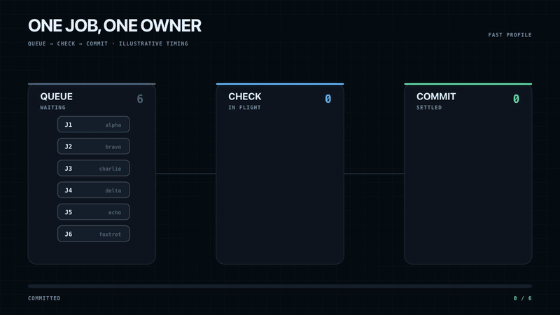
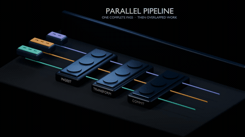
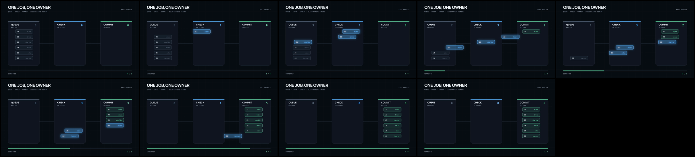
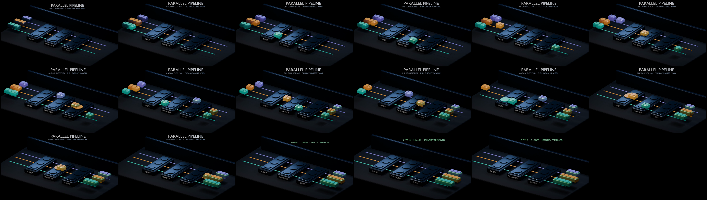

# Animation skill

Make technical explainer videos with a coding agent. Pick React/SVG for diagrams
or headless Blender for 3D; both modes render deterministic frames and verify
the final video.

## Examples

<table>
  <tr>
    <th width="50%">React + SVG</th>
    <th width="50%">Blender</th>
  </tr>
  <tr>
    <td></td>
    <td></td>
  </tr>
  <tr>
    <td></td>
    <td></td>
  </tr>
</table>

## Pick a mode

| Mode | Use it when |
| --- | --- |
| `svg` | Labels, data flow, architecture, state changes, or comparisons carry the story. |
| `blender` | Depth, materials, lighting, occlusion, or camera motion carry the story. |

Not sure? Start with SVG. It is faster to render and easier to label.

## Quick start

On macOS:

```bash
brew install node ffmpeg python@3.13
brew install --cask google-chrome blender
```

Run either example:

```bash
./animation svg install
./animation svg check
./animation svg render:video --scene task-pipeline --profile fast --output output/task-pipeline-fast.mp4

./animation blender check
./animation blender final
```

Start a new SVG scene with `./animation svg new packet-router`.

Blender mode uses `bpy` from your Blender install. This repo does not bundle
Blender. Generated frames, videos, and `.blend` files stay in ignored output
directories.

## Review SVG scenes

Run `./animation svg dev`, add `feedback=1` to the preview URL, then seek,
click an element, and leave a note. Notes go to the ignored local file
`modes/svg/feedback/feedback.jsonl`, where an agent can read and resolve them.
For example: `?scene=task-pipeline&profile=fast&autoplay=0&feedback=1`.

## Docs

- Agent instructions: [SKILL.md](SKILL.md)
- One-commit launch plan: [LAUNCH.md](LAUNCH.md)
- Shared workflow: [references/workflow.md](references/workflow.md)
- SVG: [visual direction](modes/svg/references/visual-direction.md), [architecture](modes/svg/references/architecture.md), [failure modes](modes/svg/references/failure-modes.md), [portability](modes/svg/references/portability.md), and [worked example](modes/svg/examples/task-pipeline/README.md)
- Blender: [visual direction](modes/blender/references/visual-direction.md), [project interface](modes/blender/references/project-interface.md), [failure modes](modes/blender/references/failure-modes.md), [portability](modes/blender/references/portability.md), [opinionated starter](modes/blender/templates/parallel-pipeline/README.md), and [minimal worked example](modes/blender/examples/parcel-sorter/README.md)

MIT licensed. You own the animations you make.
